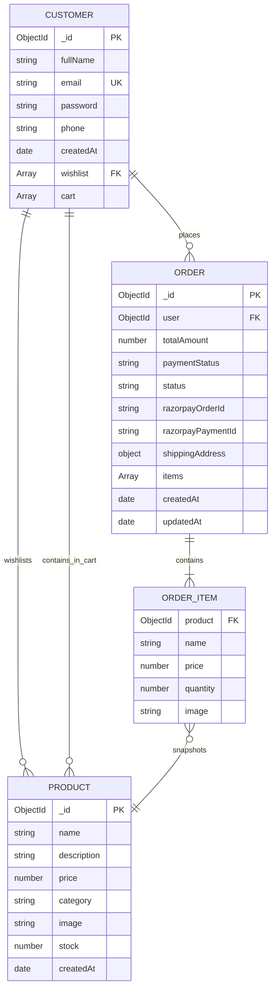

# ShopKart — Full-Stack MERN E-Commerce Platform

> **A secure, production-grade MERN e-commerce application featuring HttpOnly JWT authentication, dynamic catalog discovery, persistent user carts, Razorpay Test Mode checkout, and HMAC SHA-256 payment verification.**

[](https://nodejs.org/)
[](https://expressjs.com/)
[](https://react.dev/)
[](https://www.mongodb.com/)
[](https://vitejs.dev/)
[](https://razorpay.com/)
[](#license-and-attribution)

---

## 📑 Table of Contents

- [About ShopKart](#about-shopkart)
- [Core Features](#core-features)
- [Technology Stack](#technology-stack)
- [Application Screenshots](#application-screenshots)
- [Architecture & System Design](#architecture--system-design)
  - [High-Level Flow Diagram](#high-level-flow-diagram)
  - [Repository Structure](#repository-structure)
- [Core User Workflows](#core-user-workflows)
- [Prerequisites](#prerequisites)
- [Local Installation & Setup](#local-installation--setup)
- [Environment Variables](#environment-variables)
- [REST API Reference](#rest-api-reference)
  - [Authentication Endpoints (`/customers`)](#authentication-endpoints-customers)
  - [Product Endpoints (`/products`)](#product-endpoints-products)
  - [Wishlist Endpoints (`/wishlist`)](#wishlist-endpoints-wishlist)
  - [Cart Endpoints (`/cart`)](#cart-endpoints-cart)
  - [Order & Payment Endpoints (`/orders`)](#order--payment-endpoints-orders)
- [Database Schema & Data Modeling](#database-schema--data-modeling)
  - [Entity Relationship Diagram](#entity-relationship-diagram)
  - [Design Rationale](#design-rationale)
- [Security & Validation Architecture](#security--validation-architecture)
- [Available Scripts & Automated Testing](#available-scripts--automated-testing)
- [Troubleshooting Guide](#troubleshooting-guide)
- [Project Status & Roadmap](#project-status--roadmap)
- [License and Attribution](#license-and-attribution)

---

## About ShopKart

**ShopKart** is a full-stack e-commerce web application developed systematically across six engineering laboratory modules (Labs 01 through 06). Designed with security, data integrity, and user experience at the forefront, the application bridges client-side React interactions with an authoritative server-side Node.js/Express architecture backed by MongoDB.

With ShopKart, customers can:
1. **Register and authenticate** securely using salted bcrypt password hashing and session management through `HttpOnly` JWT cookies.
2. **Discover products** through a responsive catalog supporting debounce-assisted search, category filters, and sorting.
3. **Curate a personalized wishlist** stored directly in MongoDB.
4. **Manage a persistent shopping cart** with client-side optimistic synchronization via React Context and server-side real-time inventory validation.
5. **Checkout safely** through Razorpay Standard Checkout (Test Mode), where order amounts are verified on the server, payments are cryptographically authenticated using HMAC SHA-256 signatures, and stock is decremented in MongoDB upon payment confirmation.
6. **Review purchase history** with historical price snapshots and order status tracking.

---

## Core Features

### 1. Customer Authentication (Lab 01)
- **Email & Password Registration:** Validates customer name, phone number, unique email, and password complexity.
- **Bcrypt Password Security:** Passwords hashed with 10 salt rounds prior to persistence; credentials never stored in plaintext.
- **HttpOnly JWT Session Cookies:** Tokens issued upon login with a 1-day expiration and stored in `HttpOnly`, `SameSite` browser cookies to mitigate Cross-Site Scripting (XSS) and token extraction vulnerabilities.
- **Protected Profile:** Backend `authMiddleware` decodes token cookies, validates database existence, and attaches the customer document to `req.user`.
- **Session Termination:** Dedicated logout endpoint explicitly expires the authentication cookie.

### 2. Product Catalog & Discovery (Lab 03)
- **Catalog Browsing:** Responsive product grid displaying titles, categories, pricing, stock levels, and product images.
- **Real-Time Search:** Search bar querying product names and descriptions with regex sanitization to prevent ReDoS attacks.
- **Category Filtering:** Filter products dynamically by categories (`Electronics`, `Fashion`, `Books`, `Home`).
- **Sorting Options:** Sort products by price ascending (`price_asc`) or price descending (`price_desc`).
- **Product Details View (`/products/:id`):** Dedicated page showing high-resolution product imagery, full descriptions, stock availability tags, and direct cart/wishlist actions.

### 3. Customer Wishlist (Lab 04)
- **User-Specific Wishlists:** Wishlists stored per customer in MongoDB using ObjectId references.
- **One-Click Toggling:** Quick toggle directly from product cards or product details.
- **Dynamic Header Badge:** Real-time wishlist item counter in the navigation bar.
- **Duplicate Prevention:** Strict server-side prevention of duplicate entries returning HTTP 409 Conflict.

### 4. Persistent Shopping Cart (Lab 05)
- **Database Persistence:** Carts saved in the authenticated customer document, enabling cross-device and multi-session cart retention.
- **Global React Cart Context:** Centralized in-memory cart state consumed across the application without external state management dependencies.
- **Live Inventory Guard:** Stepper controls prevent customers from selecting quantities exceeding available stock.
- **Live Navigation Counter:** Cart unit badge updates dynamically across all routes.
- **Automatic Orphan Pruning:** Automatically cleans up cart references if an underlying product document is removed from the catalog.

### 5. Checkout & Razorpay Test Payments (Lab 06)
- **Validated Shipping Address:** Client and server-side validation enforcing non-empty fields, Indian mobile numbers (`^[6-9]\d{9}$`), and 6-digit Indian postal pincodes (`^\d{6}$`).
- **Server-Authoritative Pricing:** Client-submitted prices and totals are completely ignored; the backend recalculates line totals and orders from live database records.
- **Stock Re-Verification:** Real-time inventory verified at the millisecond of order generation to prevent overselling.
- **Paise Conversion:** Strict integer conversion (`Math.round(totalAmount * 100)`) preventing floating-point currency drift.
- **Razorpay Standard Checkout:** Official modal integration via `https://checkout.razorpay.com/v1/checkout.js`.
- **HMAC SHA-256 Verification:** Signatures cryptographically verified using Node's `crypto.timingSafeEqual` and `RAZORPAY_KEY_SECRET`.
- **Purchase-Time Snapshots:** Orders capture historical price and product name snapshots at the time of purchase, preserving accounting records against future product catalog edits.
- **Deferred Cart Clearing:** Database and React carts are cleared **only after** signature verification succeeds.

---

## Technology Stack

| Layer | Technology | Version | Purpose |
|---|---|---|---|
| **Frontend Framework** | React | `^19.2.8` | Component-based user interface and state management |
| **Client Routing** | React Router DOM | `^7.18.4` | Declarative client-side routing and browser navigation |
| **HTTP Client** | Axios | `^1.20.0` | Promise-based HTTP client configured with `withCredentials: true` |
| **Build & Tooling** | Vite | `^8.3.0` | Frontend dev server, HMR, and production bundler |
| **Frontend Linter** | Oxlint | `^1.81.0` | Fast static analysis and code linting |
| **Styling** | Vanilla CSS | CSS3 | Custom design system with tokens, variables, and responsive grids |
| **Backend Runtime** | Node.js | `>= 18.0.0` | JavaScript server runtime environment |
| **Web Framework** | Express | `^5.2.1` | RESTful API server routing and middleware pipeline |
| **Database & ODM** | MongoDB / Mongoose | `^9.10.1` | NoSQL document database and schema modeling |
| **Password Hashing** | bcrypt | `^6.0.0` | One-way cryptographic password hashing (10 salt rounds) |
| **Token Authentication**| jsonwebtoken (JWT) | `^9.0.3` | Cryptographic session tokens encoded with customer ID |
| **Cookie Parsing** | cookie-parser | `^1.4.7` | Middleware for reading and signing HTTP cookies |
| **Payment Gateway** | Razorpay Node SDK | `^2.9.8` | Order creation and payment gateway communication (Test Mode) |
| **Cryptography** | Node.js `crypto` | Built-in | HMAC SHA-256 payment signature hashing & `timingSafeEqual` |
| **Config Management** | dotenv | `^17.4.2` | Environment variable management |

---

## Application Screenshots

> *Screenshots can be placed in `docs/screenshots/` and linked below.*

| View | Description | Suggested Screenshot Asset |
|---|---|---|
| **Product Catalog** | Product discovery with search and category filters | `docs/screenshots/01_catalog.png` |
| **Product Details** | High-resolution image, stock status, and add-to-cart controls | `docs/screenshots/02_product_details.png` |
| **Shopping Cart** | Persistent cart, item steppers, and order summary | `docs/screenshots/03_cart.png` |
| **Checkout & Address** | Shipping validation and order summary preview | `docs/screenshots/04_checkout.png` |
| **Razorpay Test Modal** | Official Razorpay Test Mode checkout popup | `docs/screenshots/05_razorpay_modal.png` |
| **Order Receipt** | Confirmed order status, payment reference, and item snapshots | `docs/screenshots/06_order_success.png` |
| **Order History** | List of past customer orders with expandable details | `docs/screenshots/07_my_orders.png` |

---

## Architecture & System Design

ShopKart follows a multi-tier client-server architecture with strict separation of concerns:

```
[ Client Browser ]
        │
        ▼ (HTTPS / HTTP)
[ Vite Dev Reverse Proxy / Production Host ]
        │
        ▼ (Proxy: /customers, /products, /wishlist, /cart, /orders)
[ Express 5 REST API Server ]
        │
        ├── [ Middlewares: cookieParser, express.json, authMiddleware ]
        │
        ├── [ Controllers: customer, product, wishlist, cart, order ]
        │
        ├── [ Razorpay SDK / Node.js Crypto ] ────► [ Razorpay Payment Gateway ]
        │
        └── [ Mongoose ODM (Data Access Layer) ]
                    │
                    ▼
          [ MongoDB Database ]
```

### High-Level Flow Diagram

```mermaid
sequenceDiagram
    autonumber
    actor Customer as Customer (Browser)
    participant React as React (CartContext / UI)
    participant Express as Express Backend
    participant DB as MongoDB Database
    participant RZP as Razorpay Gateway

    Customer->>React: Add Items & Proceed to Checkout
    Customer->>React: Submit Shipping Address
    React->>Express: POST /orders/create-payment-order { shippingAddress }
    Note over Express: authMiddleware verifies JWT cookie
    Express->>DB: Fetch Customer Cart & Latest Product Records
    Note over Express: Validate stock, recalculate trusted totalAmount
    Express->>DB: Create Order (status: PENDING_PAYMENT, paymentStatus: PENDING)
    Express->>RZP: razorpay.orders.create({ amount: totalInPaise, currency: "INR" })
    RZP-->>Express: Returns razorpay_order_id
    Express->>DB: Save razorpayOrderId in Order record
    Express-->>React: Return { shopKartOrderId, razorpayOrderId, amount, razorpayKeyId }
    
    React->>RZP: Open window.Razorpay(options) modal
    Customer->>RZP: Complete Test Mode Payment
    RZP-->>React: Return { razorpay_payment_id, razorpay_signature }
    
    React->>Express: POST /orders/verify-payment { orderId, paymentId, signature }
    Note over Express: Compute HMAC SHA-256 of orderId|paymentId using Key Secret
    Note over Express: Compare signatures via crypto.timingSafeEqual()
    alt Signature Valid
        Express->>DB: Update Order (status: PLACED, paymentStatus: PAID)
        Express->>DB: Decrement Product stock ($inc: -quantity)
        Express->>DB: Clear Customer Cart (cart: [])
        Express-->>React: Return 200 OK { success: true, order }
        React->>React: clearCart() in CartContext
        React->>Customer: Navigate to /order-success/:id
    else Signature Invalid
        Express->>DB: Update Order (paymentStatus: FAILED)
        Express-->>React: Return 400 Bad Request
        Note over React: Cart is preserved; display error alert
    end
```

### Repository Structure

```
ShopKart/
├── package.json                   # Root package script runner (dev, dev:backend, dev:frontend, test, lint, build)
├── .gitignore                     # Root-level ignore (node_modules, logs, .env, .DS_Store)
├── README.md                      # Comprehensive project documentation
│
├── backend/                       # Express & Node.js API Service
│   ├── .env.example               # Environment template with placeholders
│   ├── .gitignore                 # Backend-specific ignore
│   ├── package.json               # Backend dependencies, scripts & engine specs
│   ├── index.js                   # Application entry point, Express config, MongoDB connection
│   ├── seed.js                    # Database seeder with sample products
│   ├── test_suite.js              # Automated test suite for Labs 01 - 05 (72 tests)
│   ├── test_lab06.js              # Automated test suite for Lab 06 (38 tests)
│   ├── controllers/               # Business logic & request handling
│   │   ├── customer.controller.js # Auth, registration, login, profile, password change
│   │   ├── product.controller.js  # Product catalogue, search, filters, CRUD
│   │   ├── wishlist.controller.js # Wishlist management and toggling
│   │   ├── cart.controller.js     # Cart operations, quantity updates, inventory checks
│   │   └── order.controller.js    # Order generation, Razorpay integration, HMAC verification
│   ├── middlewares/
│   │   └── auth.middleware.js     # JWT cookie extraction, verification, req.user binding
│   ├── models/                    # Mongoose database schemas
│   │   ├── customer.model.js      # Customer model (includes embedded wishlist & cart arrays)
│   │   ├── product.model.js       # Product schema (name, description, price, stock, category)
│   │   └── order.model.js         # Order schema (item snapshots, shipping, payment status)
│   └── utils/
│       ├── generateToken.js       # JWT signing utility
│       └── razorpay.js            # Razorpay SDK initialization & credential validation
│
└── frontend/                      # React 19 + Vite Single-Page Application
    ├── package.json               # Frontend dependencies & build commands
    ├── vite.config.js             # Vite configuration with API reverse proxy rules
    ├── index.html                 # HTML shell
    ├── src/
    │   ├── main.jsx               # React DOM root entry point
    │   ├── App.jsx                # React Router setup & route declarations
    │   ├── App.css                # Base application layout styles
    │   ├── index.css              # Custom design system, CSS variables & responsive rules
    │   ├── components/            # Reusable UI components
    │   │   ├── Navbar.jsx         # Navigation bar with dynamic cart & wishlist counters
    │   │   ├── ProductCard.jsx    # Product display card with wishlist/cart triggers
    │   │   └── SearchBar.jsx      # Search input, category dropdown, and price sorting
    │   ├── context/               # Global state providers
    │   │   ├── CartContext.jsx    # React Cart state, stepper mutations, clearCart action
    │   │   └── useCart.js         # Custom consumption hook for CartContext
    │   ├── pages/                 # Route page components
    │   │   ├── Register.jsx       # Customer registration page
    │   │   ├── Login.jsx          # Customer login page
    │   │   ├── Home.jsx           # Protected customer dashboard
    │   │   ├── Products.jsx       # Catalog discovery page
    │   │   ├── ProductDetails.jsx # Detailed single-product view
    │   │   ├── Wishlist.jsx       # Customer wishlist page
    │   │   ├── Cart.jsx           # Interactive shopping cart view
    │   │   ├── Checkout.jsx       # Shipping form & Razorpay payment trigger
    │   │   ├── OrderSuccess.jsx   # Post-payment confirmation receipt
    │   │   └── Orders.jsx         # My Orders purchase history page
    │   └── services/              # API abstraction clients (Axios)
    │       ├── api.js             # Centralized Axios client with withCredentials: true
    │       ├── cartService.js     # Cart API integration
    │       ├── productService.js  # Product API integration
    │       ├── wishlistService.js # Wishlist API integration
    │       └── orderService.js    # Order and payment verification API integration
    └── public/                    # Static assets & icons
```

---

## Core User Workflows

### 1. Registration & Authentication Flow
1. Visitor navigates to `/register` and provides full name, email, password, and phone number.
2. Backend validates fields, hashes password with `bcrypt.hash(password, 10)`, and saves customer to MongoDB.
3. Customer navigates to `/login`. Upon successful credential verification, backend signs a JWT payload (`{ sub: customerId }`) and sets an `HttpOnly` cookie named `token`.
4. Browser stores cookie automatically; subsequent Axios requests send this cookie via `withCredentials: true`.
5. Authenticated views (`/home`, `/wishlist`, `/cart`, `/checkout`, `/orders`) verify session authenticity via `authMiddleware`.

### 2. Catalog Browsing & Wishlist Flow
1. User navigates to `/products`.
2. As user types in the search bar, debounce timer (250ms) fires `GET /products?search=...&category=...&sort=...`.
3. User clicks heart icon on any card; if authenticated, `POST /wishlist/:productId` adds item reference to `customer.wishlist`.
4. Navbar wishlist badge increments immediately.

### 3. Shopping Cart Flow
1. User clicks "Add to Cart" on a product card or product details page.
2. `CartContext` dispatches `POST /cart/:productId`. Server verifies current inventory before appending item or incrementing quantity.
3. On `/cart`, user can adjust units with stepper controls (`-` and `+`). Quantities cannot drop below 1 or exceed available product inventory (`product.stock`).
4. Navbar cart badge displays total accumulated item units across all lines.

### 4. Checkout & Payment Verification Flow
1. User clicks "Proceed to Checkout" on `/cart` and navigates to `/checkout`.
2. User fills out shipping address. Client validates 10-digit Indian phone and 6-digit pincode.
3. Form submission triggers `POST /orders/create-payment-order`.
4. Backend verifies that the cart is not empty, queries the latest Product records from MongoDB, validates that requested quantities do not exceed current stock, recalculates the trusted server total, and generates a draft Order (`PENDING_PAYMENT`).
5. Backend creates a Razorpay order via Razorpay SDK with the amount in paise (`Math.round(totalAmount * 100)`).
6. Frontend opens the Razorpay Standard Checkout modal.
7. Upon completing test payment, the Razorpay handler submits payment credentials to `POST /orders/verify-payment`.
8. Backend constructs HMAC SHA-256 signature using `order.razorpayOrderId + "|" + razorpay_payment_id` and `process.env.RAZORPAY_KEY_SECRET`.
9. Signatures are compared in constant time with `crypto.timingSafeEqual`.
10. On match:
    - Order is updated to `status: "PLACED"` and `paymentStatus: "PAID"`.
    - Inventory is deducted (`$inc: { stock: -quantity }`).
    - Customer cart in MongoDB is cleared (`customer.cart = []`).
    - Server returns HTTP 200.
11. Frontend calls `clearCart()` in `CartContext` and redirects to `/order-success/:id`.

---

## Prerequisites

Before running ShopKart locally, ensure you have:

- **Node.js**: `v18.x` or `v20.x` LTS ([Download Node.js](https://nodejs.org/))
- **npm**: `v9.x` or `v10.x` (bundled with Node.js)
- **MongoDB**: Active MongoDB database instance (Local MongoDB on `mongodb://127.0.0.1:27017/shopkart` or a [MongoDB Atlas](https://www.mongodb.com/atlas) connection URI)
- **Razorpay Account (Test Mode)**: Free account on [Razorpay](https://dashboard.razorpay.com/) to obtain Test API Keys (`Key ID` and `Key Secret`)
- **Git**: Installed command-line Git client

---

## Local Installation & Setup

### 1. Clone the Repository
```bash
git clone https://github.com/CodedStars-hub/ShopKart.git
cd ShopKart
```

### 2. Configure Backend Environment
Navigate into the backend directory and copy the environment template:
```bash
cd backend
cp .env.example .env
```
Open `.env` and fill in your configuration:
```env
PORT=5001
MONGO_URI=mongodb://127.0.0.1:27017/shopkart
JWT_SECRET=your_super_secret_jwt_key_here
JWT_EXPIRES_IN=1d
NODE_ENV=development
RAZORPAY_KEY_ID=rzp_test_your_key_id_here
RAZORPAY_KEY_SECRET=your_razorpay_key_secret_here
```
> ⚠️ **Security Notice**: Never commit `.env` to Git. The `.gitignore` file is configured to keep it private.

### 3. Install Dependencies
Install packages for both tiers from the repository root:
```bash
# Return to root directory if inside backend/
cd ..

# Install backend dependencies
npm --prefix backend install

# Install frontend dependencies
npm --prefix frontend install
```

### 4. Seed Sample Product Catalog
Populate MongoDB with default e-commerce products across multiple categories:
```bash
npm --prefix backend run seed
```

### 5. Start Development Servers

You can start both frontend and backend concurrently using the root runner:
```bash
npm run dev
```

Or run them in separate terminals:

**Terminal 1 (Backend API Service):**
```bash
npm --prefix backend run dev
# Starts backend server on http://localhost:5001 with node --watch
```

**Terminal 2 (Frontend Client):**
```bash
npm --prefix frontend run dev
# Starts Vite development server on http://localhost:5173
```

### 6. Access the Application
Open your browser and navigate to:
```
http://localhost:5173
```

---

## Environment Variables

All environment variables used by the backend are detailed below:

| Variable | Scope | Description | Required | Example Placeholder |
|---|---|---|:---:|---|
| `PORT` | Backend | Port number for Express server | No (Default: `5000`) | `5001` |
| `MONGO_URI` | Backend | MongoDB connection string (Local or Atlas) | **Yes** | `mongodb://127.0.0.1:27017/shopkart` |
| `JWT_SECRET` | Backend | Cryptographic secret for signing JWT auth tokens | **Yes** | `your_secret_jwt_key_random_string` |
| `JWT_EXPIRES_IN` | Backend | Token validity duration | No (Default: `1d`) | `1d` |
| `NODE_ENV` | Backend | Environment mode (`development` / `production`) | No (Default: `development`) | `development` |
| `RAZORPAY_KEY_ID` | Backend | Public Key ID for Razorpay Test Mode gateway | **Yes** | `rzp_test_XXXXXXXXXXXXXX` |
| `RAZORPAY_KEY_SECRET` | Backend | Private Secret Key for HMAC SHA-256 signatures | **Yes** | `XXXXXXXXXXXXXXXXXXXXXXXX` |

> 🔒 **Critical Security Rule**:
> - `RAZORPAY_KEY_SECRET` is **strictly backend-only**. It is never referenced in frontend code, never returned in API responses, and never logged.
> - The frontend receives only `RAZORPAY_KEY_ID` from the backend order creation endpoint to initialize the payment modal.

---

## REST API Reference

All protected endpoints require the `token` cookie set upon login.

### Authentication Endpoints (`/customers`)

| Method | Endpoint | Auth | Description |
|---|---|:---:|---|
| `POST` | `/customers/register` | Public | Register new customer account |
| `POST` | `/customers/login` | Public | Authenticate customer and set HttpOnly JWT cookie |
| `GET` | `/customers/me` | **Required** | Get profile of authenticated customer |
| `POST` | `/customers/logout` | **Required** | Clear authentication cookie |
| `PATCH`| `/customers/change-password` | **Required** | Update password after verifying old password |

#### Sample Registration Request (`POST /customers/register`):
```json
{
  "fullName": "Aarav Sharma",
  "email": "aarav@example.com",
  "password": "password123",
  "phone": "9876543210"
}
```

---

### Product Endpoints (`/products`)

| Method | Endpoint | Auth | Description |
|---|---|:---:|---|
| `GET` | `/products` | Public | List products (Supports `?search=`, `?category=`, `?sort=`) |
| `GET` | `/products/:id` | Public | Retrieve single product details by MongoDB ObjectId |
| `POST` | `/products` | Public | Create new product (Catalog management) |
| `PUT` | `/products/:id` | Public | Update existing product details |
| `DELETE`| `/products/:id` | Public | Remove product from catalog |

---

### Wishlist Endpoints (`/wishlist`)

| Method | Endpoint | Auth | Description |
|---|---|:---:|---|
| `GET` | `/wishlist` | **Required** | Retrieve populated wishlist items for logged-in customer |
| `POST` | `/wishlist/:productId` | **Required** | Add product to customer wishlist |
| `DELETE`| `/wishlist/:productId` | **Required** | Remove product from customer wishlist |
| `POST` | `/wishlist/toggle/:productId` | **Required** | Toggle product in/out of wishlist |

---

### Cart Endpoints (`/cart`)

| Method | Endpoint | Auth | Description |
|---|---|:---:|---|
| `GET` | `/cart` | **Required** | Fetch populated cart items for logged-in customer |
| `POST` | `/cart/:productId` | **Required** | Add product to cart or increment quantity by 1 |
| `PATCH`| `/cart/:productId` | **Required** | Update specific cart item quantity (`{ quantity: 3 }`) |
| `DELETE`| `/cart/:productId` | **Required** | Remove product line from customer cart |

---

### Order & Payment Endpoints (`/orders`)

| Method | Endpoint | Auth | Description |
|---|---|:---:|---|
| `POST` | `/orders/create-payment-order` | **Required** | Validate cart/stock, compute server total, create Razorpay order |
| `POST` | `/orders/verify-payment` | **Required** | Verify HMAC payment signature, mark PAID, deduct stock, clear cart |
| `GET` | `/orders` | **Required** | List all orders belonging to authenticated customer (newest first) |
| `GET` | `/orders/:id` | **Required** | Retrieve full details of an order owned by the authenticated customer |

#### Sample Create Payment Order Request (`POST /orders/create-payment-order`):
```json
{
  "shippingAddress": {
    "fullName": "Aarav Sharma",
    "phone": "9876543210",
    "addressLine1": "22 MG Road, Koramangala",
    "city": "Bengaluru",
    "state": "Karnataka",
    "pincode": "560001"
  }
}
```

#### Sample Create Payment Order Response (`201 Created`):
```json
{
  "success": true,
  "shopKartOrderId": "66d1234567890abcdef12345",
  "razorpayOrderId": "order_NXyz1234567890",
  "amount": 299900,
  "currency": "INR",
  "razorpayKeyId": "rzp_test_XXXXXXXXXXXXXX"
}
```

#### Sample Payment Verification Request (`POST /orders/verify-payment`):
```json
{
  "shopKartOrderId": "66d1234567890abcdef12345",
  "razorpay_order_id": "order_NXyz1234567890",
  "razorpay_payment_id": "pay_NYabc123456789",
  "razorpay_signature": "a1b2c3d4e5f6g7h8i9j0k1l2m3n4o5p6q7r8s9t0u1v2w3x4y5z6"
}
```

---

## Database Schema & Data Modeling

ShopKart utilizes three primary collections in MongoDB: `customers`, `products`, and `orders`.

### Entity Relationship Diagram



### Design Rationale

1. **Embedded Cart & Wishlist in Customer:**
   - E-commerce cart lookups and updates occur frequently for a single user. Embedding cart items as `{ product: ObjectId, quantity: Number }` inside the `Customer` document provides single-document atomic updates and avoids extra collection joins.
2. **Snapshot Modeling in Order Items:**
   - Order items in `Order.items` store embedded snapshots:
     ```javascript
     {
       product: ObjectId,
       name: String,
       price: Number,
       quantity: Number,
       image: String
     }
     ```
   - This ensures that if product catalog details (like price or description) change in the future, past order records and invoices remain completely unchanged.
3. **Reference Integrity:**
   - `Order.user` explicitly references `"Customer"` with Mongoose ObjectId types, maintaining referential integrity and user ownership enforcement.

---

## Security & Validation Architecture

ShopKart implements layered security controls across both tiers:

1. **HttpOnly Cookie Architecture (XSS Protection):**
   - Authentication tokens are delivered strictly via `HttpOnly` cookies. JavaScript running in the browser cannot read `document.cookie`, preventing token exfiltration via Cross-Site Scripting (XSS).
2. **Server-Side Authoritative Totals (Tamper Prevention):**
   - The client never dictates prices or totals. Even if an attacker modifies client-side JavaScript or submits a modified JSON body (`totalAmount: 1`), the backend calculates the checkout total by multiplying quantities with trusted database prices.
3. **Inventory Race Condition Mitigation:**
   - Product stock is verified both when adding to cart and during checkout order creation. Upon verified payment, stock is atomically decremented using MongoDB's `$inc` operator.
4. **Timing-Safe HMAC SHA-256 Signature Verification:**
   - Signatures generated by Razorpay are verified on the server using `crypto.timingSafeEqual` with buffer length guards. This eliminates timing side-channel attacks.
5. **Strict Data Access Isolation:**
   - Every cart, wishlist, and order query filters records by `req.user._id` (derived from the verified JWT cookie). Accessing another customer's order ID returns HTTP 403 Forbidden.
6. **Input Sanitization & Validation:**
   - Client-side validation is backed by strict server-side validation. Whitespace-only strings, malformed phone numbers, and invalid postal codes are rejected with descriptive HTTP 400 Bad Request responses.
7. **Safe Failure Handling:**
   - If gateway order creation fails or signature verification fails, customer carts are preserved and orders are marked `FAILED`. No user loses their cart due to a payment interruption.

---

## Available Scripts & Automated Testing

### Root Directory Scripts
```bash
npm run dev           # Concurrently start backend (port 5001) and frontend (port 5173)
npm run dev:backend   # Start backend only in development mode
npm run dev:frontend  # Start frontend only in development mode
npm test              # Run complete backend test suite (Labs 01 - 06)
npm run lint          # Run frontend linter (Oxlint)
npm run build         # Build production frontend bundle
```

### Backend Directory Scripts (`backend/`)
```bash
npm start             # Start Express server in production mode
npm run dev           # Start Express server with file watch mode (node --watch)
npm test              # Run complete test runner (72 regression tests + 38 Lab 06 tests)
npm run test:labs1-5  # Run test suite verifying Labs 01 through 05
npm run test:lab06    # Run dedicated test suite for Lab 06 checkout & Razorpay flow
npm run seed          # Seed MongoDB with sample products
```

### Frontend Directory Scripts (`frontend/`)
```bash
npm run dev           # Start Vite development server (port 5173)
npm run build         # Build optimized production bundle into dist/
npm run lint          # Lint frontend JavaScript and JSX files with Oxlint
npm run preview       # Preview production build locally
```

### Automated Test Coverage Summary

Running `npm test` executes **110 automated tests** against live MongoDB instances:

```
==================================================
RUNNING SHOPKART BACKEND AUTOMATED TEST SUITE
==================================================
  ✓ LAB 01: Customer Registration, Password Hashing, Duplicate Prevention, Login, JWT Cookies, Profile
  ✓ LAB 03: Product Catalog, Single Product, ID Validation, Search, Category Filter, Sorting
  ✓ LAB 04: Wishlist Addition, Duplicate Prevention, Populated Fetch, Removal, Isolation, Toggle
  ✓ LAB 05: Cart Addition, Row Deduplication, Quantity Updates, Inventory Validation, Cart Persistence
  ==================================================
  ALL 72/72 TESTS PASSED SUCCESSFULLY!
  ==================================================

==================================================
RUNNING SHOPKART LAB 06 AUTOMATED TEST SUITE
==================================================
  ✓ 1. Unauthenticated checks return 401 across all order endpoints
  ✓ 2. Empty cart order creation rejected with 400
  ✓ 3. Shipping validation: empty fields, whitespace, invalid phone, non-6-digit pincode rejected
  ✓ 4. Stock validation: stock overflow and deleted products rejected
  ✓ 5. Server calculation: ignores client total tampering, computes trusted total
  ✓ 6. Database cart preserved during checkout creation
  ✓ 7. Fake signature rejected with 400; order marked FAILED; cart preserved
  ✓ 8. Valid HMAC SHA-256 signature verified with 200 OK; order marked PAID and PLACED
  ✓ 9. Product stock decremented atomically upon verification
  ✓ 10. Database cart cleared only after verification passes
  ✓ 11. Idempotent response for repeated verification attempts
  ✓ 12. Cross-user access to orders denied with 403 Forbidden
  ✓ 13. Historical order retains purchase-time price and name snapshots after product edits
  ==================================================
  ALL LAB 06 TESTS PASSED! (38/38 PASS)
  ==================================================
```

---

## Troubleshooting Guide

### 1. MongoDB Connection Error (`querySrv ECONNREFUSED` or timeout)
- **Cause:** Network DNS restriction or invalid connection string in `backend/.env`.
- **Solution:** 
  - If using MongoDB Atlas, verify your IP address is whitelisted in MongoDB Atlas Network Access (`0.0.0.0/0` for development).
  - If using local MongoDB, ensure the MongoDB daemon is active (`brew services start mongodb-community` on macOS, or `sudo systemctl start mongod` on Linux).

### 2. Port Already in Use (`EADDRINUSE: :::5001` or `5173`)
- **Cause:** A previous Node or Vite process is still running in the background.
- **Solution:**
  ```bash
  # Check and kill process on port 5001
  lsof -i :5001
  kill -9 <PID>

  # Check and kill process on port 5173
  lsof -i :5173
  kill -9 <PID>
  ```

### 3. Razorpay Script Loading Failure
- **Cause:** Network interruption or content blockers blocking `https://checkout.razorpay.com/v1/checkout.js`.
- **Solution:** Verify your internet connection. Disable browser extensions that block external payment gateway scripts during testing.

### 4. Razorpay Signature Verification Failed (HTTP 400)
- **Cause:** Mismatched `RAZORPAY_KEY_SECRET` between your Razorpay Dashboard and `backend/.env`.
- **Solution:** Verify that both `RAZORPAY_KEY_ID` and `RAZORPAY_KEY_SECRET` in `backend/.env` belong to the exact same Razorpay account and are in **Test Mode** (Key IDs start with `rzp_test_`).

### 5. Cookies Not Being Stored or 401 Unauthorized in Browser
- **Cause:** Cross-origin cookie blocking or opening the frontend via IP instead of `localhost`.
- **Solution:** Access the application strictly through `http://localhost:5173`. Ensure requests go through the Vite reverse proxy configured in `frontend/vite.config.js`.

---

## Project Status & Roadmap

ShopKart has achieved 100% completion across all Engineering Labs (01 through 06):
- [x] **Lab 01**: Customer Authentication, Bcrypt Hashing, JWT HttpOnly Cookies
- [x] **Lab 02**: Responsive Layout & Core CSS Design Tokens
- [x] **Lab 03**: Dynamic Product Catalog, Full-Text Search, Filtering & Sorting
- [x] **Lab 04**: Customer Wishlist with Real-Time Counters & Toggle Actions
- [x] **Lab 05**: Persistent Shopping Cart, Stepper Controls & Global Context State
- [x] **Lab 06**: Checkout Flow, Razorpay Test Payments, HMAC Verification & Order History

### Potential Future Improvements
- [ ] **Webhook Handling:** Add Razorpay Webhooks (`payment.captured`, `payment.failed`) for asynchronous out-of-band payment reconciliation.
- [ ] **Order Invoicing:** PDF invoice generation and automated email dispatch upon successful checkout.
- [ ] **Admin Dashboard:** Role-based access control for inventory and order status management.
- [ ] **CI/CD Pipeline:** GitHub Actions workflow for automated linting, test execution, and deployment.

---

## License and Attribution

- **License:** Developed for academic evaluation under the Engineering Laboratory curriculum. Formal software licensing to be determined.
- **Third-Party Libraries & Services:**
  - UI Icons & Imagery: Unsplash open-source photography.
  - Payment Processing: Razorpay Software Development Kit (Test Mode).
  - Open Source Dependencies: Node.js, Express, React, Vite, Mongoose, Axios, bcrypt, jsonwebtoken.
