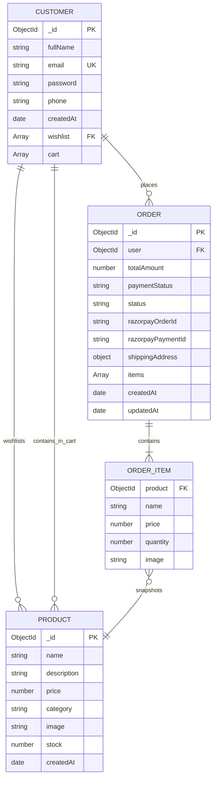

<p align="center">
  <picture>
    <source media="(prefers-color-scheme: dark)" srcset="frontend/public/logo-dark.png">
    <source media="(prefers-color-scheme: light)" srcset="frontend/public/logo.png">
    
  </picture>
</p>

<p align="center">
  <strong>Your next favourite, just a click away.</strong>
</p>

<p align="center">
  A full-stack MERN e-commerce application engineered with HttpOnly JWT authentication, dynamic product catalog discovery, persistent user carts, Razorpay Test Mode checkout, and HMAC SHA-256 payment verification.
</p>

<p align="center">
  <a href="https://react.dev/"></a>
  <a href="https://nodejs.org/"></a>
  <a href="https://expressjs.com/"></a>
  <a href="https://www.mongodb.com/"></a>
  <a href="https://vitejs.dev/"></a>
  <a href="https://razorpay.com/"></a>
  <a href="https://developer.mozilla.org/en-US/docs/Web/JavaScript"></a>
</p>

---

## Table of Contents

- [About ShopKart](#about-shopkart)
- [Core Features](#core-features)
  - [Authentication & Account Security](#1-authentication--account-security)
  - [Product Discovery & Catalog](#2-product-discovery--catalog)
  - [Customer Wishlist](#3-customer-wishlist)
  - [Persistent Shopping Cart](#4-persistent-shopping-cart)
  - [Checkout, Payments & Order Management](#5-checkout-payments--order-management)
- [Application Screenshots](#application-screenshots)
- [Technology Stack](#technology-stack)
- [Architecture & Technical Design](#architecture--technical-design)
  - [System Overview](#system-overview)
  - [Checkout & Payment Verification Sequence](#checkout--payment-verification-sequence)
  - [Client-Server Communication & Data Flows](#client-server-communication--data-flows)
- [Repository Structure](#repository-structure)
- [Prerequisites](#prerequisites)
- [Local Installation & Setup](#local-installation--setup)
- [Environment Variables](#environment-variables)
- [REST API Reference](#rest-api-reference)
  - [Customer Endpoints (`/customers`)](#customer-endpoints-customers)
  - [Product Endpoints (`/products`)](#product-endpoints-products)
  - [Wishlist Endpoints (`/wishlist`)](#wishlist-endpoints-wishlist)
  - [Cart Endpoints (`/cart`)](#cart-endpoints-cart)
  - [Order & Payment Endpoints (`/orders`)](#order--payment-endpoints-orders)
- [Database Models & Relationships](#database-models--relationships)
  - [Entity Relationship Diagram](#entity-relationship-diagram)
  - [Data Design Rationale](#data-design-rationale)
- [Security & Validation Architecture](#security--validation-architecture)
- [Testing & Quality Checks](#testing--quality-checks)
  - [Automated Test Suite Summary](#automated-test-suite-summary)
  - [Code Quality & Build Verification](#code-quality--build-verification)
- [Troubleshooting](#troubleshooting)
- [Project Status & Roadmap](#project-status--roadmap)
- [License & Attribution](#license--attribution)

---

## About ShopKart

**ShopKart** is a full-stack e-commerce web platform developed across six progressive engineering laboratory stages. Designed with security, data integrity, and a responsive shopping experience at its core, the application couples a modular React 19 single-page client with an authoritative Express 5 REST API backed by MongoDB.

### Target Users & Use Cases
- **Shoppers:** Browse a curated catalog across Electronics, Fashion, Books, and Home categories; execute real-time debounced searches; save items to personal wishlists; manage cart quantities with inventory-guarded stepper controls; and complete end-to-end checkout using Razorpay Test Mode.
- **Account Owners:** Maintain authenticated sessions secured with HttpOnly cookies, review previous orders with historical price snapshots, and update account credentials securely.

### Engineering Problems Addressed
1. **Session Hijacking & XSS Defense:** Authentication tokens are stored strictly in `HttpOnly`, `SameSite` browser cookies rather than browser `localStorage` or `sessionStorage`, making tokens inaccessible to malicious client-side scripts.
2. **Server-Authoritative Pricing:** Client-submitted prices and totals are completely ignored during checkout. Line item costs and grand totals are computed server-side directly from authoritative MongoDB records to prevent price-tampering attacks.
3. **Inventory Race Conditions:** Inventory levels are verified when adding items to cart, re-validated at the moment of payment order creation, and atomically decremented in MongoDB upon cryptographic signature verification.
4. **Cryptographic Payment Integrity:** Payment signatures are verified using server-side HMAC SHA-256 computation and constant-time buffer comparison (`crypto.timingSafeEqual`), preventing signature spoofing and timing attacks.
5. **Historical Snapshot Integrity:** Order records embed immutable snapshots of item names, prices, and quantities at the time of purchase. Future changes to catalog pricing do not corrupt past invoices or accounting records.
6. **Graceful Payment Failure Handling:** Customer carts remain preserved in the database until payment signature verification succeeds. Payment cancellations or modal dismissals never result in lost carts.

---

## Core Features

### 1. Authentication & Account Security
- **Input Validation:** Enforces non-empty full name, normalized unique email address, password complexity, and 10-digit Indian phone numbers (`^[6-9]\d{9}$`).
- **One-Way Password Hashing:** User passwords are encrypted with bcrypt using 10 salt rounds before persistence; plaintext credentials are never logged or stored.
- **HttpOnly JWT Sessions:** JSON Web Tokens signed with `JWT_SECRET` (1-day expiration) are issued inside an `HttpOnly`, `SameSite` cookie (`token`), mitigating XSS token extraction.
- **Protected Routing:** Backend `authMiddleware` validates JWT cookies, confirms customer existence in MongoDB, and attaches the customer document to `req.user`.
- **Credential Management:** Dedicated endpoints for profile retrieval (`GET /customers/me`), password changes with previous-password verification (`PATCH /customers/change-password`), and session termination (`POST /customers/logout`).

### 2. Product Discovery & Catalog
- **Storefront Landing Page (`/home`):** Curated customer portal featuring a hero banner, category cards with direct catalog filtering, live featured items with working cart/wishlist triggers, platform shopping benefits, and a collapsible customer profile drawer.
- **Dynamic Catalog Grid (`/products`):** Responsive grid displaying product photography, titles, categories, pricing, stock levels, and quick-action triggers.
- **Debounced Search:** Live search queries matching product names and descriptions with special-character escaping to prevent Regular Expression Denial of Service (ReDoS).
- **Multi-Category Filtering:** Filter products by `Electronics`, `Fashion`, `Books`, and `Home` with synchronized URL search parameters (`?category=...`).
- **Price Sorting:** Sort catalog results dynamically by price ascending (`price_asc`) and descending (`price_desc`).
- **Product Details View (`/products/:id`):** Dedicated view with high-resolution imagery, full product descriptions, live stock status badges, and interactive cart/wishlist controls.

### 3. Customer Wishlist
- **Customer Data Isolation:** Wishlist items are stored per-user inside the `Customer` document using MongoDB ObjectId references.
- **One-Click Toggling:** Quick-toggle capability (`PATCH /wishlist/:productId/toggle`) alongside explicit add (`POST`) and remove (`DELETE`) routes.
- **Dynamic Navigation Badge:** Real-time wishlist item counter displayed in the navigation bar.
- **Duplicate Prevention:** Server-side validation rejects duplicate wishlist additions with HTTP 409 Conflict.

### 4. Persistent Shopping Cart
- **Database Persistence:** Carts are embedded directly within the customer's database record, persisting items across different browsers, tabs, and login sessions.
- **Global React Cart Context:** Centralized state provider (`CartContext`) providing synchronized cart item counts, line updates, and total calculations across all routes.
- **Live Inventory Steppers:** Client and server bounds enforce quantities between 1 and the maximum available inventory (`product.stock`).
- **Automatic Orphan Pruning:** Automatically detects and purges cart references if an underlying product is removed from the catalog.

### 5. Checkout, Payments & Order Management
- **Validated Shipping Address:** Strict client and server validation enforcing recipient name, address lines, city, state, 10-digit Indian mobile number, and 6-digit Indian postal pincode (`^\d{6}$`).
- **Server Total Recalculation:** The backend computes grand totals directly from verified database prices and converts amounts to paise (`Math.round(totalAmount * 100)`) to eliminate floating-point arithmetic errors.
- **Razorpay Standard Checkout:** Official Razorpay JavaScript modal (`checkout.js`) integration handling test card, UPI, and netbanking flows.
- **Cryptographic Payment Verification:** Computes HMAC SHA-256 over `order.razorpayOrderId + "|" + razorpay_payment_id` using `RAZORPAY_KEY_SECRET` and verifies signatures with `crypto.timingSafeEqual`.
- **Atomic Stock Decrement:** Stock counts are decremented atomically (`$inc: { stock: -quantity }`) in MongoDB only after signature verification passes.
- **Deferred Cart Clearing:** The user's cart is emptied in both MongoDB and React Context only upon verified payment.
- **Order Confirmation & History:** Post-payment receipt (`/order-success/:id`) and full order history (`/orders`) displaying purchase-time item snapshots, shipping addresses, payment references, and current fulfillment status.

---

## Application Screenshots

> **Note on Visual Assets:** To keep the repository lightweight and free of transient binary artifacts, screenshot files are not pre-committed to Git. The table below specifies the verified application views and their recommended capture locations for project submissions.

| View | Route | Key Verification Elements | Suggested Target Path |
|---|---|---|---|
| **Storefront Home** | `/home` | Hero banner, category cards, featured items, benefits ribbon, profile drawer | `docs/screenshots/01_storefront_home.png` |
| **Product Catalog** | `/products` | Category filters, search input, price sorting, distinct product cards | `docs/screenshots/02_catalog.png` |
| **Product Details** | `/products/:id` | High-res image, category badge, price, stock counter, Add to Cart action | `docs/screenshots/03_product_details.png` |
| **Customer Wishlist**| `/wishlist` | Populated wishlist items, remove triggers, direct Move to Cart action | `docs/screenshots/04_wishlist.png` |
| **Shopping Cart** | `/cart` | Line items, inventory stepper controls, order summary card, checkout button | `docs/screenshots/05_cart.png` |
| **Checkout & Shipping**| `/checkout` | Shipping address fields, 6-digit pincode validation, Pay with Razorpay CTA | `docs/screenshots/06_checkout.png` |
| **Razorpay Test Modal**| `/checkout` | Official Razorpay modal popup with Test Mode badge and payment options | `docs/screenshots/07_razorpay_modal.png` |
| **Order Confirmation** | `/order-success/:id` | Order ID, Razorpay payment reference, item snapshots, shipping address | `docs/screenshots/08_order_success.png` |
| **Order History** | `/orders` | Order chronology, status badges (`PLACED`, `PAID`), historical price snapshots | `docs/screenshots/09_my_orders.png` |

---

## Technology Stack

| Layer / Role | Technology | Version | Purpose in Application |
|---|---|---|---|
| **Frontend Framework** | React | `^19.2.8` | Component hierarchy, state management, and declarative UI rendering |
| **Client Routing** | React Router DOM | `^7.18.4` | Declarative client-side routing, protected routes, and URL query param sync |
| **HTTP Client** | Axios | `^1.20.0` | Promise-based HTTP client configured with `withCredentials: true` for cookie transport |
| **Build Tool & Bundler**| Vite | `^8.3.0` | Frontend dev server, Hot Module Replacement (HMR), and production build bundler |
| **Frontend Linter** | Oxlint | `^1.81.0` | High-performance Rust-based linter enforcing clean React patterns and JSX hygiene |
| **Styling Architecture**| Vanilla CSS | CSS3 | Custom design system using design tokens, CSS variables, and responsive flex/grid layouts |
| **Backend Runtime** | Node.js | `>= 18.0.0` | Cross-platform asynchronous JavaScript server runtime |
| **Web Framework** | Express | `^5.2.1` | RESTful API server routing, middleware pipeline, and JSON request parsing |
| **Database & ODM** | MongoDB / Mongoose | `^9.10.1` | Document database and object data modeling with strict validation and schemas |
| **Password Hashing** | bcrypt | `^6.0.0` | One-way cryptographic password hashing using 10 salt rounds |
| **Session Authentication**| jsonwebtoken (JWT) | `^9.0.3` | Cryptographic session tokens encoded with customer ID and expiration |
| **Cookie Parsing** | cookie-parser | `^1.4.7` | Middleware for reading and signing HTTP cookies from incoming request headers |
| **Payment Gateway** | Razorpay Node SDK | `^2.9.8` | Server-side Razorpay order generation and API communication |
| **Cryptographic Utilities**| Node.js `crypto` | Built-in | HMAC SHA-256 signature hashing and constant-time `timingSafeEqual` comparison |
| **Configuration** | dotenv | `^17.4.2` | Loading environment variables from `.env` files |

---

## Architecture & Technical Design

### System Overview

ShopKart follows a decoupled client-server architecture with clear tier boundaries:

```
┌─────────────────────────────────────────────────────────────┐
│                       Client Browser                        │
│   React 19 SPA (Vite) + Context API + React Router DOM v7   │
└──────────────────────────────┬──────────────────────────────┘
                               │
                               │ HTTPS / HTTP (withCredentials: true)
                               │ Vite Dev Reverse Proxy (:5173 -> :5001)
                               ▼
┌─────────────────────────────────────────────────────────────┐
│                    Express 5 REST API                       │
│                                                             │
│   Middlewares: cookieParser, express.json, authMiddleware   │
│                                                             │
│   Controllers:                                              │
│   ├── customer.controller.js  (Auth, JWT cookies, Profile)  │
│   ├── product.controller.js   (Catalog, Search, Filters)    │
│   ├── wishlist.controller.js  (Wishlist management)         │
│   ├── cart.controller.js      (Cart persistence, Steppers)  │
│   └── order.controller.js     (Pricing, Razorpay, HMAC)     │
└──────────────┬──────────────────────────────┬───────────────┘
               │                              │
               │ Mongoose ODM                 │ Razorpay SDK / Node crypto
               ▼                              ▼
┌──────────────────────────────┐ ┌────────────────────────────┐
│       MongoDB Database       │ │  Razorpay Payment Gateway  │
│ Collections:                 │ │  (Test Mode Standard API)  │
│ - customers (users+cart+wish)│ └────────────────────────────┘
│ - products  (catalog items)  │
│ - orders    (snapshots)      │
└──────────────────────────────┘
```

### Checkout & Payment Verification Sequence

The diagram below details the interaction between the customer browser, the React client, the Express backend, the MongoDB database, and the Razorpay gateway during order creation and payment verification:

```mermaid
sequenceDiagram
    autonumber
    actor Customer as Customer (Browser)
    participant React as React Client (CartContext)
    participant Express as Express REST API
    participant DB as MongoDB Database
    participant RZP as Razorpay Gateway

    Customer->>React: Submit Shipping Address & Click Pay
    React->>Express: POST /orders/create-payment-order { shippingAddress }
    Note over Express: authMiddleware validates JWT cookie
    Express->>DB: Fetch Customer Cart & Live Product Records
    Note over Express: Verify stock levels & calculate server-authoritative totalAmount
    Express->>DB: Create Order (status: PENDING_PAYMENT, paymentStatus: PENDING)
    Express->>RZP: razorpay.orders.create({ amount: totalInPaise, currency: "INR" })
    RZP-->>Express: Returns { id: razorpay_order_id }
    Express->>DB: Save razorpayOrderId to Order document
    Express-->>React: Return { shopKartOrderId, razorpayOrderId, amount, razorpayKeyId }
    
    React->>RZP: window.Razorpay(options).open()
    Customer->>RZP: Select Test Payment Method & Authorize
    RZP-->>React: Callback returns { razorpay_payment_id, razorpay_signature }
    
    React->>Express: POST /orders/verify-payment { shopKartOrderId, razorpay_order_id, razorpay_payment_id, razorpay_signature }
    Note over Express: Compute HMAC SHA-256(order_id + "|" + payment_id, RAZORPAY_KEY_SECRET)
    Note over Express: Verify signature via crypto.timingSafeEqual()
    
    alt Signature Valid
        Express->>DB: Update Order (status: PLACED, paymentStatus: PAID, paymentId)
        Express->>DB: Atomically decrement product stock ($inc: -quantity)
        Express->>DB: Clear customer cart in MongoDB (cart: [])
        Express-->>React: Return 200 OK { success: true, order }
        React->>React: clearCart() in CartContext
        React->>Customer: Redirect to /order-success/:id
    else Signature Invalid
        Express->>DB: Update Order (paymentStatus: FAILED)
        Express-->>React: Return 400 Bad Request { success: false, message: "Invalid payment signature" }
        Note over React: Cart is preserved; display alert to customer
    end
```

### Client-Server Communication & Data Flows

1. **Reverse Proxy Configuration:** In development, Vite's dev server proxies `/customers`, `/products`, `/wishlist`, `/cart`, and `/orders` directly to `http://localhost:5001`. This eliminates cross-origin issues during local development.
2. **Credentialed Requests:** The central Axios instance in [`frontend/src/services/api.js`](file:///Users/harshitagupta/ShopKart/frontend/src/services/api.js) is configured with `withCredentials: true`, ensuring the browser transmits the `HttpOnly` token cookie on every request.
3. **Optimistic UI with Authoritative Sync:** State in `CartContext` updates immediately for responsive user feedback, but every mutation synchronizes against the backend to ensure local inventory counts cannot drift from server truth.

---

## Repository Structure

```
ShopKart/
├── package.json                   # Root workspace scripts (dev, test, lint, build)
├── .gitignore                     # Git ignore rules for dependencies, env files, and logs
├── README.md                      # Comprehensive project documentation
│
├── backend/                       # Node.js & Express API Server
│   ├── .env.example               # Environment variable configuration template
│   ├── .gitignore                 # Backend-specific ignore rules
│   ├── package.json               # Backend dependencies, scripts, and engine metadata
│   ├── index.js                   # Application entry point, Express middleware & MongoDB setup
│   ├── seed.js                    # Database seeder populating catalog products
│   ├── update_product_images.js   # Image migration script for catalog photos
│   ├── test_suite.js              # Automated regression test suite for Labs 01-05 (72 tests)
│   ├── test_lab06.js              # Automated test suite for Lab 06 checkout & Razorpay (38 tests)
│   │
│   ├── controllers/               # Route controller logic
│   │   ├── customer.controller.js # Registration, login, profile, and password update
│   │   ├── product.controller.js  # Catalog retrieval, filtering, search, and details
│   │   ├── wishlist.controller.js # Wishlist fetch, add, remove, and toggle
│   │   ├── cart.controller.js     # Cart fetch, add, stepper quantity update, and remove
│   │   └── order.controller.js    # Order creation, Razorpay integration, HMAC verification
│   │
│   ├── middlewares/
│   │   └── auth.middleware.js     # JWT cookie extraction, verification, and req.user binding
│   │
│   ├── models/                    # Mongoose database schemas
│   │   ├── customer.model.js      # Customer schema with embedded cart & wishlist arrays
│   │   ├── product.model.js       # Product catalog schema with stock validation
│   │   └── order.model.js         # Order schema with item snapshots & payment statuses
│   │
│   ├── routes/                    # Express route definitions
│   │   ├── customer.routes.js     # /customers routes
│   │   ├── product.routes.js      # /products routes
│   │   ├── wishlist.routes.js     # /wishlist routes
│   │   ├── cart.routes.js         # /cart routes
│   │   └── order.routes.js        # /orders routes
│   │
│   └── utils/                     # Backend helper utilities
│       ├── generateToken.js       # JWT signing helper
│       └── razorpay.js            # Razorpay SDK initialization & credential validation
│
└── frontend/                      # React 19 + Vite Single-Page Application
    ├── .oxlintrc.json             # Oxlint linter configuration
    ├── package.json               # Frontend dependencies, build commands, and dev scripts
    ├── vite.config.js             # Vite configuration with API reverse proxy rules
    ├── index.html                 # HTML application entry point
    │
    ├── public/                    # Static public assets
    │   ├── logo.png               # ShopKart logo (light background variant)
    │   ├── logo-dark.png          # ShopKart logo (dark background variant)
    │   └── logo-icon.png          # Standalone cart monogram & browser favicon
    │
    └── src/
        ├── main.jsx               # React DOM initialization
        ├── App.jsx                # React Router DOM route hierarchy & CartProvider wrapper
        ├── index.css              # Cobalt-Blue design tokens, typography, and responsive styles
        │
        ├── assets/                # Bundled graphic assets
        │   ├── logo.png           # Bundled light-variant logo
        │   ├── logo-dark.png      # Bundled dark-variant logo
        │   └── logo-icon.png      # Bundled brand icon
        │
        ├── components/            # Reusable UI components
        │   ├── Navbar.jsx         # Header navigation with brand logo & dynamic badge counters
        │   ├── Footer.jsx         # Global storefront footer with dark logo variant
        │   ├── ProductCard.jsx    # Product display card with wishlist & cart triggers
        │   ├── SearchBar.jsx      # Search input, category dropdown, and price sort controls
        │   └── ShopKartLogo.jsx   # Responsive brand logo component supporting light/dark variants
        │
        ├── context/               # Global state providers
        │   ├── CartContext.jsx    # React Cart Context provider managing cart state & sync
        │   └── useCart.js         # Custom consumer hook for CartContext
        │
        ├── pages/                 # Route page components
        │   ├── Home.jsx           # Storefront landing page & customer dashboard (/home)
        │   ├── Products.jsx       # Dynamic product catalog & filtering (/products)
        │   ├── ProductDetails.jsx # Detailed single-product view (/products/:id)
        │   ├── Wishlist.jsx       # Customer wishlist (/wishlist)
        │   ├── Cart.jsx           # Interactive shopping cart (/cart)
        │   ├── Checkout.jsx       # Shipping address form & Razorpay trigger (/checkout)
        │   ├── OrderSuccess.jsx   # Order confirmation & receipt (/order-success/:id)
        │   ├── Orders.jsx         # Order history page (/orders)
        │   ├── Login.jsx          # Customer login (/login)
        │   └── Register.jsx       # Customer registration (/register)
        │
        ├── services/              # API communication layer (Axios)
        │   ├── api.js             # Base Axios instance with withCredentials: true
        │   ├── productService.js  # Catalog API calls
        │   ├── wishlistService.js # Wishlist API calls
        │   ├── cartService.js     # Cart API calls
        │   └── orderService.js    # Order & payment verification API calls
        │
        └── utils/                 # Frontend helper utilities
            └── productImages.js   # Deterministic fallback image resolver by category/keyword
```

---

## Prerequisites

Before running ShopKart locally, ensure your environment meets the following requirements:

- **Node.js:** `v18.x` or `v20.x` LTS recommended (tested on Node.js `>= 18.0.0`)
- **npm:** `v9.x` or `v10.x` (bundled with Node.js)
- **MongoDB:** Active MongoDB instance:
  - Local installation running at `mongodb://127.0.0.1:27017/shopkart`, OR
  - A [MongoDB Atlas](https://www.mongodb.com/atlas) connection URI
- **Razorpay Account (Test Mode):** Free account at [Razorpay Dashboard](https://dashboard.razorpay.com/) to obtain test API credentials (`Key ID` starting with `rzp_test_` and `Key Secret`)
- **Git:** Command-line Git installed

---

## Local Installation & Setup

Follow these steps to set up and run ShopKart locally:

### 1. Clone the Repository
```bash
git clone https://github.com/CodedStars-hub/ShopKart.git
cd ShopKart
```

### 2. Configure Backend Environment Variables
Navigate into the `backend/` directory, copy the environment template, and populate your credentials:
```bash
cd backend
cp .env.example .env
```
Open `backend/.env` in your editor and configure the variables:
```env
PORT=5001
MONGO_URI=mongodb://127.0.0.1:27017/shopkart
JWT_SECRET=your_secure_random_jwt_secret_here
JWT_EXPIRES_IN=1d
NODE_ENV=development
RAZORPAY_KEY_ID=rzp_test_your_key_id_here
RAZORPAY_KEY_SECRET=your_razorpay_key_secret_here
```
> ⚠️ **Important Security Rule:** Never commit `backend/.env` to version control. Both root `.gitignore` and `backend/.gitignore` are configured to prevent tracking environment files.

### 3. Install Dependencies
Return to the project root and install packages for both the backend and frontend:
```bash
cd ..

# Install backend dependencies
npm --prefix backend install

# Install frontend dependencies
npm --prefix frontend install
```

### 4. Seed the Product Catalog
Populate your MongoDB database with sample catalog products across Electronics, Fashion, Books, and Home categories:
```bash
npm --prefix backend run seed
```

### 5. Start Development Servers
You can start both tiers simultaneously from the repository root:
```bash
npm run dev
```

Alternatively, you can run them in separate terminal sessions:

**Terminal 1 (Backend API Service):**
```bash
npm run dev:backend
# Express API starts on http://localhost:5001 with node --watch
```

**Terminal 2 (Frontend Client):**
```bash
npm run dev:frontend
# Vite development server starts on http://localhost:5173
```

### 6. Verify and Access the Application
- Open your browser and navigate to: **`http://localhost:5173`**
- The backend health endpoint is accessible at: **`http://localhost:5001/`**

---

## Environment Variables

All environment variables used by the application are defined in `backend/.env` (see [`backend/.env.example`](file:///Users/harshitagupta/ShopKart/backend/.env.example)):

| Variable | Tier | Required | Purpose | Safe Example Placeholder |
|---|:---:|:---:|---|---|
| `PORT` | Backend | No | Port number on which the Express server listens (default: `5000`) | `5001` |
| `MONGO_URI` | Backend | **Yes** | MongoDB connection string (Local or MongoDB Atlas) | `mongodb://127.0.0.1:27017/shopkart` |
| `JWT_SECRET` | Backend | **Yes** | Cryptographic secret key used to sign and verify session JWTs | `your_secure_random_jwt_secret` |
| `JWT_EXPIRES_IN` | Backend | No | Lifespan of generated JWT tokens (default: `1d`) | `1d` |
| `NODE_ENV` | Backend | No | Node execution environment (`development` / `production`) | `development` |
| `RAZORPAY_KEY_ID` | Backend | **Yes** | Public Key ID for Razorpay Test Mode integration | `rzp_test_your_key_id` |
| `RAZORPAY_KEY_SECRET` | Backend | **Yes** | Secret Key used to generate and verify HMAC SHA-256 signatures | `your_razorpay_key_secret` |

> 🔒 **Critical Security Architecture:**
> - `RAZORPAY_KEY_SECRET` is **strictly backend-only**. It is never imported into frontend code, never returned in API payloads, and never logged.
> - The frontend receives only `razorpayKeyId` inside the order response payload to initialize the client-side checkout modal.

---

## REST API Reference

All protected endpoints require the `token` cookie set during customer login.

### Customer Endpoints (`/customers`)

| Method | Endpoint | Auth | Description | Request Body / Parameters |
|---|---|:---:|---|---|
| `POST` | `/customers/register` | Public | Register a new customer account | `{ fullName, email, password, phone }` |
| `POST` | `/customers/login` | Public | Authenticate customer and set HttpOnly JWT cookie | `{ email, password }` |
| `GET` | `/customers/me` | **Required** | Retrieve authenticated customer profile | None |
| `POST` | `/customers/logout` | **Required** | Clear authentication session cookie | None |
| `PATCH`| `/customers/change-password` | **Required** | Update password with old-password verification | `{ oldPassword, newPassword }` |

#### Registration Request Example (`POST /customers/register`):
```json
{
  "fullName": "Aarav Sharma",
  "email": "aarav@example.com",
  "password": "Password123!",
  "phone": "9876543210"
}
```

---

### Product Endpoints (`/products`)

| Method | Endpoint | Auth | Description | Query / Body Parameters |
|---|---|:---:|---|---|
| `GET` | `/products` | Public | List catalog products with search, filter, and sort | `?search=keyboard&category=Electronics&sort=price_asc` |
| `GET` | `/products/:id` | Public | Retrieve detailed product record by MongoDB ObjectId | Path param: `:id` |
| `POST` | `/products` | Public | Add a new product to catalog | `{ name, description, price, category, image, stock }` |

---

### Wishlist Endpoints (`/wishlist`)

| Method | Endpoint | Auth | Description | Parameters |
|---|---|:---:|---|---|
| `GET` | `/wishlist` | **Required** | Retrieve populated wishlist items for authenticated customer | None |
| `POST` | `/wishlist/:productId` | **Required** | Add a product to customer wishlist (returns 409 if duplicate) | Path param: `:productId` |
| `DELETE`| `/wishlist/:productId` | **Required** | Remove a product from customer wishlist (returns 404 if not found)| Path param: `:productId` |
| `PATCH`| `/wishlist/:productId/toggle` | **Required** | Toggle product in/out of wishlist (returns `{ saved: boolean }`)| Path param: `:productId` |

---

### Cart Endpoints (`/cart`)

| Method | Endpoint | Auth | Description | Request Body / Parameters |
|---|---|:---:|---|---|
| `GET` | `/cart` | **Required** | Fetch populated cart items for authenticated customer | None |
| `POST` | `/cart/:productId` | **Required** | Add item to cart or increment quantity by 1 | Path param: `:productId` |
| `PATCH`| `/cart/:productId` | **Required** | Set specific quantity for cart item (bounded by stock) | Path: `:productId`, Body: `{ quantity: 3 }` |
| `DELETE`| `/cart/:productId` | **Required** | Remove item line completely from customer cart | Path param: `:productId` |

---

### Order & Payment Endpoints (`/orders`)

| Method | Endpoint | Auth | Description | Request Body / Parameters |
|---|---|:---:|---|---|
| `POST` | `/orders/create-payment-order` | **Required** | Validate stock, compute server total, create Razorpay order | `{ shippingAddress: { fullName, phone, addressLine1, city, state, pincode } }` |
| `POST` | `/orders/verify-payment` | **Required** | Verify HMAC payment signature, mark PAID, deduct stock, clear cart | `{ shopKartOrderId, razorpay_order_id, razorpay_payment_id, razorpay_signature }` |
| `GET` | `/orders` | **Required** | List all orders placed by authenticated customer (newest first) | None |
| `GET` | `/orders/:id` | **Required** | Retrieve single order details (enforces customer ownership) | Path param: `:id` |

#### Create Payment Order Request (`POST /orders/create-payment-order`):
```json
{
  "shippingAddress": {
    "fullName": "Aarav Sharma",
    "phone": "9876543210",
    "addressLine1": "Flat 402, Sunshine Apartments, MG Road",
    "city": "Bengaluru",
    "state": "Karnataka",
    "pincode": "560001"
  }
}
```

#### Create Payment Order Response (`201 Created`):
```json
{
  "success": true,
  "shopKartOrderId": "66d1234567890abcdef12345",
  "razorpayOrderId": "order_NXyz1234567890",
  "amount": 299900,
  "currency": "INR",
  "razorpayKeyId": "rzp_test_your_key_id"
}
```

#### Verify Payment Request (`POST /orders/verify-payment`):
```json
{
  "shopKartOrderId": "66d1234567890abcdef12345",
  "razorpay_order_id": "order_NXyz1234567890",
  "razorpay_payment_id": "pay_NYabc123456789",
  "razorpay_signature": "a1b2c3d4e5f6g7h8i9j0k1l2m3n4o5p6q7r8s9t0u1v2w3x4y5z6"
}
```

---

## Database Models & Relationships

### Entity Relationship Diagram



### Data Design Rationale

1. **Embedded Cart & Wishlist Arrays in `Customer`:**
   - E-commerce cart and wishlist queries occur on nearly every authenticated request. Embedding them as subdocuments within the `Customer` document allows atomic updates via MongoDB array operators (`$push`, `$pull`, `$set`), eliminating multi-collection joins and maintaining fast reads.
2. **Item Snapshot Architecture in `Order`:**
   - Instead of referencing catalog products dynamically, each item in `order.items` stores an immutable snapshot:
     ```javascript
     {
       product: ObjectId,  // Original catalog reference
       name: String,        // Purchase-time product title
       price: Number,       // Purchase-time unit price
       quantity: Number,    // Units purchased
       image: String        // Product image URL at checkout
     }
     ```
   - This ensures that subsequent catalog price revisions, product description edits, or deletions never alter historical invoices or order accounting records.
3. **Referential Integrity on Orders:**
   - `order.user` holds a strict `ref: "Customer"` reference, ensuring every order is permanently associated with its owner for authorization checks.

---

## Security & Validation Architecture

| Security Domain | Implemented Protection | Verification Mechanism |
|---|---|---|
| **Credential Storage** | Salted bcrypt password hashing | Passwords hashed with 10 salt rounds; plaintext is never persisted or logged |
| **Session Security** | HttpOnly JWT browser cookies | Tokens delivered in `HttpOnly`, `SameSite` cookies; inaccessible to JavaScript (`document.cookie`), mitigating XSS token theft |
| **Route Protection** | `authMiddleware` | Decodes JWT cookie, verifies user existence in MongoDB, and rejects unauthenticated requests with HTTP 401 |
| **Price Tampering** | Server-authoritative recalculation | Client-submitted totals are ignored; backend multiplies item quantities by live database prices |
| **Currency Drift** | Integer paise conversion | Totals converted to integer paise (`Math.round(totalAmount * 100)`) preventing floating-point rounding errors |
| **Payment Authenticity**| HMAC SHA-256 signature verification | Backend hashes `order_id + "|" + payment_id` with `RAZORPAY_KEY_SECRET` and checks equality with `crypto.timingSafeEqual` |
| **Inventory Guards** | Multi-phase stock validation | Stock verified upon adding to cart, re-checked at checkout order creation, and atomically decremented via `$inc: -quantity` upon verified payment |
| **Cart Preservation** | Deferred cart clearing | Cart is cleared in MongoDB only after cryptographic signature verification succeeds; payment cancellations preserve cart state |
| **Data Isolation** | Scoped user queries | Orders, carts, and wishlists are queried exclusively by authenticated `req.user._id`; unauthorized access returns HTTP 403 |
| **Input Sanitization** | Regex and type validation | Client and server enforce non-empty strings, 10-digit Indian phone numbers, 6-digit postal pincodes, and sanitized search queries |

---

## Testing & Quality Checks

### Automated Test Suite Summary

The backend includes comprehensive automated test runners executing **110 integration tests** against a live MongoDB connection:

```bash
# Run all 110 tests from project root
npm test
```

#### Breakdown of Executed Test Suites:
- **`npm run test:labs1-5` (72 Tests - `backend/test_suite.js`):**
  - Customer registration, duplicate email rejection, bcrypt verification, login, JWT cookie issuance, authenticated profile lookup.
  - Product creation, invalid field validation, catalog retrieval, single-product lookup, debounced search, category filter, price sorting.
  - Wishlist item addition, duplicate addition rejection (409), populated retrieval, item removal, user isolation, toggle route.
  - Cart addition, item deduplication, quantity increments, stock-limit boundary enforcement, quantity reduction, item deletion, multi-user cart isolation, database persistence.
- **`npm run test:lab06` (38 Tests - `backend/test_lab06.js`):**
  - Unauthenticated access rejection across all checkout and order routes (401).
  - Empty cart rejection (400), invalid shipping address validation (name, phone format, 6-digit pincode).
  - Stock deficit detection during order creation, deleted product detection.
  - Server total calculation ignoring client price tampering.
  - Order document generation, cart preservation during pending payment.
  - Fake signature rejection (400), order marking as `FAILED`, cart preservation on fake signature.
  - Valid HMAC SHA-256 signature verification (200), order status transition to `PAID` / `PLACED`.
  - Atomic stock decrement in MongoDB, authenticated customer cart clearing.
  - Verification idempotency, cross-customer order isolation (403), historical price snapshot verification after catalog modifications.

```
==================================================
SHOPKART AUTOMATED TEST RUNNER RESULTS
==================================================
  ✓ Labs 01 - 05 Regression Test Suite:  72 / 72 PASSED
  ✓ Lab 06 Checkout & Razorpay Suite:     38 / 38 PASSED
==================================================
  TOTAL: 110 / 110 TESTS PASSED (100% PASS RATE)
==================================================
```

### Code Quality & Build Verification

```bash
# Frontend static analysis via Oxlint
npm run lint

# Frontend production build compilation
npm run build
```
- **Linter Status:** **0 warnings, 0 errors** across 26 files (104 rules checked with Oxlint).
- **Production Build:** Vite bundle built cleanly in ~170ms with optimized asset chunking.

---

## Troubleshooting

### 1. MongoDB Connection Timeout or `querySrv ECONNREFUSED`
- **Cause:** Network DNS restriction or invalid connection string in `backend/.env`.
- **Solution:**
  - If using MongoDB Atlas, ensure your current IP address is added to the IP Access List in the MongoDB Atlas dashboard (`0.0.0.0/0` allows access from any network during development).
  - If using local MongoDB, ensure the MongoDB daemon is active (`brew services start mongodb-community` on macOS, or `sudo systemctl start mongod` on Linux).

### 2. Port Already in Use (`EADDRINUSE: :::5001` or `5173`)
- **Cause:** A previous Node.js or Vite process is lingering on the target port.
- **Solution:**
  ```bash
  # Find and terminate processes on ports 5001 and 5173
  lsof -ti :5001 | xargs kill -9
  lsof -ti :5173 | xargs kill -9
  ```

### 3. Razorpay Signature Verification Failure (HTTP 400)
- **Cause:** Discrepancy between `RAZORPAY_KEY_ID` and `RAZORPAY_KEY_SECRET` in `backend/.env`.
- **Solution:**
  - Verify that both keys originate from the same Razorpay account.
  - Ensure the keys are generated in **Test Mode** (Key IDs begin with `rzp_test_`).
  - Restart the backend server after editing `.env` to load the updated credentials.

### 4. Authentication Cookie Not Stored / 401 Unauthorized in Browser
- **Cause:** Accessing the frontend via IP address rather than `localhost`, or cross-origin cookie restrictions.
- **Solution:**
  - Access the application strictly through **`http://localhost:5173`**.
  - Requests must traverse the Vite reverse proxy configured in `frontend/vite.config.js` to ensure the cookie origin matches.

### 5. Razorpay Checkout Modal Fails to Open
- **Cause:** Ad-blockers or browser privacy extensions blocking the external script (`checkout.razorpay.com/v1/checkout.js`).
- **Solution:** Temporarily disable content blockers or whitelist `http://localhost:5173` in your browser.

---

## Project Status & Roadmap

ShopKart has achieved complete implementation across all six engineering lab stages:

- [x] **Lab 01:** Customer Registration, Password Hashing, JWT HttpOnly Session Cookies
- [x] **Lab 02:** Responsive UI Foundations & Cohesive Cobalt-Blue Design System
- [x] **Lab 03:** Dynamic Product Catalog, Debounced Search, Category Filtering & Price Sorting
- [x] **Lab 04:** Customer Wishlist with Real-Time Counters & Database Isolation
- [x] **Lab 05:** Persistent Shopping Cart, Stepper Controls & Global React Context
- [x] **Lab 06:** Checkout Shipping Validation, Razorpay Test Payments, HMAC Verification & Order History

### Future Considerations & Production Enhancements
- [ ] **Asynchronous Webhooks:** Implement Razorpay webhooks (`payment.captured`, `payment.failed`) to reconcile payments in the event of client-side browser disconnects.
- [ ] **Automated Invoicing:** Generate downloadable PDF receipts and automated confirmation emails upon successful payment.
- [ ] **Administrative Dashboard:** Role-based portal for inventory management, product updates, and order fulfillment status updates.
- [ ] **CI/CD Automation:** GitHub Actions workflow running Oxlint and automated test suites on pull requests.

---

## License & Attribution

- **Academic Context:** Developed as an engineering laboratory project under the MERN Stack curriculum.
- **Backend License Specification:** Backend `package.json` specifies `"license": "ISC"`.
- **External Services & Libraries:**
  - Payment Gateway: [Razorpay](https://razorpay.com/) (Test Mode API).
  - Photography Assets: High-resolution catalog photography sourced from [Unsplash](https://unsplash.com/).
  - Open Source Ecosystem: Node.js, Express, React, Vite, MongoDB, Mongoose, Axios, bcrypt, jsonwebtoken, and cookie-parser.
